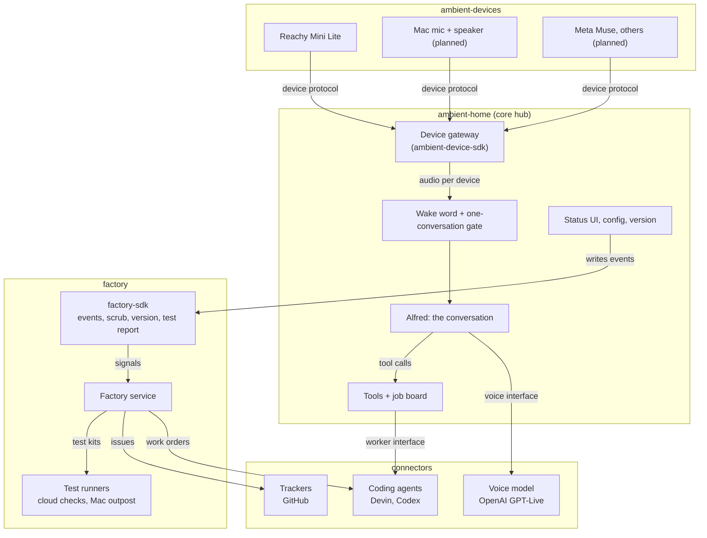

# ambient-home architecture: four public repos

Status: draft for review. Nothing has been moved yet. This doc is the target that the
untangle and split steps aim at.

## 1. The four parts

ambient-home started as one package that did everything. It is being split into four
parts. Each part becomes its own public repo.

| Repo | What it is | Depends on |
|---|---|---|
| **ambient-home** (exists) | The core hub: device gateway, wake word, one-conversation gate, Alfred (the conversation), tools and jobs, status UI, config, version, installer. It also ships the tiny `ambient-device-sdk` package. | connectors, factory-sdk |
| **ambient-devices** (new) | Device connectors ("front doors"), one package per device: Reachy Mini Lite now, then Mac mic + speaker, Meta Muse and other house devices. Each has its own test kit. | `ambient-device-sdk` only |
| **connectors** (new, name open) | Outside services, each behind a small interface: the voice model (OpenAI GPT-Live), coding agents (Devin, Codex), trackers (GitHub). | nothing of ours |
| **factory** (new, name open) | `factory-sdk` plus the factory service: intake, PM triage, plan, build, test, release, confirm. See [factory-interface-v0.md](factory-interface-v0.md) (PR #34). | connectors |



## 2. Rules

1. **Dependencies go one way.** devices → `ambient-device-sdk`; core → connectors and
   `factory-sdk`; factory → connectors. Nothing imports the core except the core itself.
   The factory never imports ambient-home: it only sees an app's events and its
   `factory.toml`.
2. **A connector knows nothing about who calls it.** The Devin connector doesn't know about
   ambient-home's job board or the factory's work orders. Each caller maps its own objects
   onto the connector's plain request and status types.
3. **The core works with no device attached.** It starts, serves the status page and waits.
   A device can connect, drop and come back without restarting the core.
4. **The wake word runs in the hub,** on each device's audio stream. Devices stay simple.
5. **One conversation at a time.** The device that wakes Alfred owns the session. A wake from
   another device while busy is ignored and logged (`wake.ignored_busy`). The daily budget
   and session limits are global.
6. **Events stay on each install.** The core writes them with `factory-sdk` to a local log.
   Nothing is sent anywhere unless the user chooses to.
7. **Boundaries are checked by a test.** A boundary test in each repo fails if a package
   imports something its rules don't allow (for example `ambient_home` importing
   `reachy_mini`).

## 3. Contracts

These are sketches of the shapes, not final code. Names will settle during the untangle.

### 3.1 Device protocol (`ambient-device-sdk`)

Every device connector implements this. The package has no heavy dependencies (no numpy
types in the signatures, just PCM16 bytes), so a connector for a small device doesn't
pull in the core.

```python
class Capability(StrEnum):
    LISTEN = "listen"    # streams mic audio to the hub
    SPEAK = "speak"      # plays audio from the hub
    MOVE = "move"        # has body tools (look, nod, wake/sleep moves)
    SEE = "see"          # camera
    TEXT = "text"        # "request device": sends text asks instead of audio


@dataclass(frozen=True)
class AudioFormat:
    sample_rate: int     # e.g. 16000 in, 24000 out
    channels: int = 1    # PCM16 little-endian


class Device(Protocol):
    id: str                          # "reachy-desk"
    kind: str                        # "reachy-mini-lite"
    capabilities: frozenset[Capability]
    mic_format: AudioFormat | None
    speaker_format: AudioFormat | None

    async def start(self) -> None: ...
    async def stop(self) -> None: ...
    async def health(self) -> DeviceHealth: ...         # ok / degraded / down + reason

    def mic(self) -> AsyncIterator[bytes]: ...          # LISTEN
    async def play(self, pcm16: bytes) -> None: ...     # SPEAK
    async def stop_playback(self) -> None: ...          # user talks over Alfred
    def requests(self) -> AsyncIterator[str]: ...       # TEXT

    def tools(self) -> Sequence[ToolSpec]: ...          # device tools, e.g. look
    async def on_session(self, state: SessionState) -> None: ...  # wake/sleep moves
```

`ToolSpec` is shared by device tools and core tools, so the core can hand all of them to
the voice model the same way:

```python
@dataclass(frozen=True)
class ToolSpec:
    name: str
    description: str
    parameters: dict[str, object]                  # JSON Schema
    handler: Callable[[dict[str, object]], Awaitable[dict[str, object]]]
```

Devices that need their own helper process (the Reachy daemon) manage it inside the
connector. The core never waits for it.

### 3.2 Voice model (connectors)

The realtime speech connection. Alfred talks to the model only through this, so the
OpenAI-specific code lives in one place.

```python
@dataclass(frozen=True)
class VoiceSessionConfig:
    instructions: str
    voice: str
    tools: Sequence[ToolSchema]        # name, description, parameters (no handler)
    input_format: AudioFormat
    output_format: AudioFormat


class VoiceModel(Protocol):
    name: str                          # "openai-gpt-live"
    async def open(self, config: VoiceSessionConfig) -> VoiceSession: ...


class VoiceSession(Protocol):
    async def send_audio(self, pcm16: bytes) -> None: ...
    def events(self) -> AsyncIterator[VoiceEvent]: ...
    # VoiceEvent is one of: AudioOut, Transcript(role, text, final), ToolCall(id, name, args),
    # SpeechStarted, ResponseDone, Error(code, message), Closed(reason)
    async def send_tool_result(self, call_id: str, result: dict[str, object]) -> None: ...
    async def say(self, text: str) -> None: ...      # announcements, greetings
    async def close(self) -> None: ...
```

### 3.3 Coding agent (connectors)

Today's `jobs/worker.py` `Worker` takes ambient-home's `Job`. In the connectors repo it
takes a plain request instead, so the factory can use the same connector.

```python
@dataclass(frozen=True)
class TaskRequest:
    prompt: str
    title: str | None = None
    repository: str | None = None
    tags: Sequence[str] = ()
    platform: str | None = None                  # e.g. an outpost, for hardware tests
    output_schema: dict[str, object] | None = None
    max_cost: float | None = None                # e.g. ACUs for Devin


@dataclass(frozen=True)
class TaskStatus:
    id: str
    url: str | None
    state: Literal["queued", "working", "blocked", "done", "failed"]
    question: str | None = None                  # when blocked
    pr_url: str | None = None
    output: dict[str, object] | None = None      # structured output
    cost: float | None = None
    error: str | None = None


class CodingAgent(Protocol):
    name: str                                    # "devin", "codex"
    async def start(self, request: TaskRequest) -> TaskStatus: ...
    async def refresh(self, task_id: str) -> TaskStatus: ...
    async def answer(self, task_id: str, text: str) -> None: ...
```

ambient-home's `JobService` maps `Job` to and from these types. The factory maps its work
orders to them.

### 3.4 Tracker (connectors)

From today's `factory/github.py`, without the `factory:*` label names. Those belong to the
factory.

```python
class Tracker(Protocol):
    name: str                                    # "github"
    async def list_issues(self, label: str) -> list[IssueRecord]: ...
    async def create_issue(self, title: str, body: str, labels: Sequence[str]) -> IssueRecord: ...
    async def update_issue(self, number: int, *, title: str | None = None,
                           body: str | None = None, state: str | None = None) -> None: ...
    async def ensure_labels(self, labels: Mapping[str, tuple[str, str]]) -> None: ...
    async def add_labels(self, number: int, labels: Sequence[str]) -> None: ...
    async def remove_label(self, number: int, label: str) -> None: ...
    async def comment(self, number: int, body: str) -> None: ...
```

### 3.5 Events, manifest, work order, proof (factory-sdk)

Defined in [factory-interface-v0.md](factory-interface-v0.md). The core only uses the
events part: `emit(type, component, level, **data)`, which writes to the local log.

## 4. Where today's files go

| Today | Goes to |
|---|---|
| `wake_word.py`, `session_gate.py`, `audio.py` (preroll), `models/hey_alfred.onnx` | ambient-home |
| `live_handler.py`: conversation, persona, tool routing, gate | ambient-home |
| `live_handler.py`: OpenAI Live connection and event parsing | connectors (voice model) |
| `live_handler.py`: `_wake_robot`, `_sleep_robot`, movement | ambient-devices (Reachy) |
| `jobs/board.py`, `jobs/service.py`, `costs.py`, `spend_log.py` | ambient-home |
| `jobs/worker.py`, `jobs/devin.py` | connectors (coding agent) |
| `reachy_tools/` dispatch_job, job_status, answer_job, spend_report, end_conversation | ambient-home, as plain `ToolSpec` tools |
| `reachy_tools/look.py` | ambient-devices (Reachy device tool) |
| `daemon.py`, `mic_check.py`, `hw_test.py`, `scripts/run-daemon.sh`, daemon LaunchAgent | ambient-devices (Reachy) |
| `main.py`, `config.py`, `runtime.py`, `service.py`, `ui.py`, `ui/index.html` (jobs, costs), app LaunchAgent | ambient-home |
| `telemetry/` | factory (`factory-sdk`) |
| `incidents/`, `incident_rules.toml`, `factory/report.py`, `factory/dispatch.py`, `factory/cli.py`, the Incidents page | factory (service) |
| `factory/github.py` | connectors (tracker) |
| ambient-home's rules, test kit and outpost steps (hard-coded in `factory/dispatch.py` today) | ambient-home's `factory.toml` |

`reachy-mini-conversation-app` (Pollen's package) is used today for the conversation
handler base class, tool classes, prompts and the local audio stream. After the untangle,
only the Reachy connector depends on it, if at all.

## 5. How we get there

1. **This doc.** Agree the parts, rules and contracts.
2. **Untangle inside this repo, with no change in behavior.** One PR per item. Each passes
   ruff, mypy, pytest and the ~2 min robot check (`ambient-hw-test`, no `--live`) before
   merge.
   1. The core stops importing factory code; the Incidents page moves to the factory side.
   2. The OpenAI, Devin and GitHub code moves behind the connector interfaces (3.2–3.4).
   3. Alfred's conversation stops being the robot's body: `GPTLiveHandler` no longer
      subclasses Pollen's `ConversationHandler`; robot moves go through `on_session`.
   4. The device gateway (3.1), with Reachy as the first connector. The core starts without
      the Reachy daemon.
   5. The core tools become plain `ToolSpec` tools instead of Pollen `Tool` classes.

   At the end, `src/` has one top-level package per future repo, and the boundary test
   enforces the rules in section 2. The trickiest part is keeping the preroll buffer and the
   XMOS mic recovery working when the audio moves behind the device protocol.
3. **Split into the four repos,** keeping git history. ambient-home keeps its issues.
4. **Package each repo** ([#30](https://github.com/sesh11/ambient-home/issues/30),
   re-scoped). At first, packages install straight from GitHub, with no PyPI.
5. **Add the Mac mic + speaker connector,** then Meta Muse.

## 6. Open questions

1. Names for the connectors repo and the factory repo. The connectors repo shouldn't start
   with `ambient-`, because the factory uses it too.
2. Does `factory-sdk` live in the factory repo (suggested) or in its own repo?
3. Does `ambient-device-sdk` live in ambient-home (suggested, since the core owns the
   protocol) or in ambient-devices?
